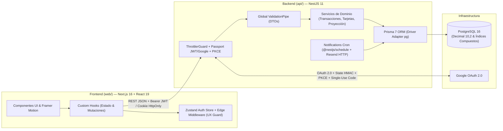
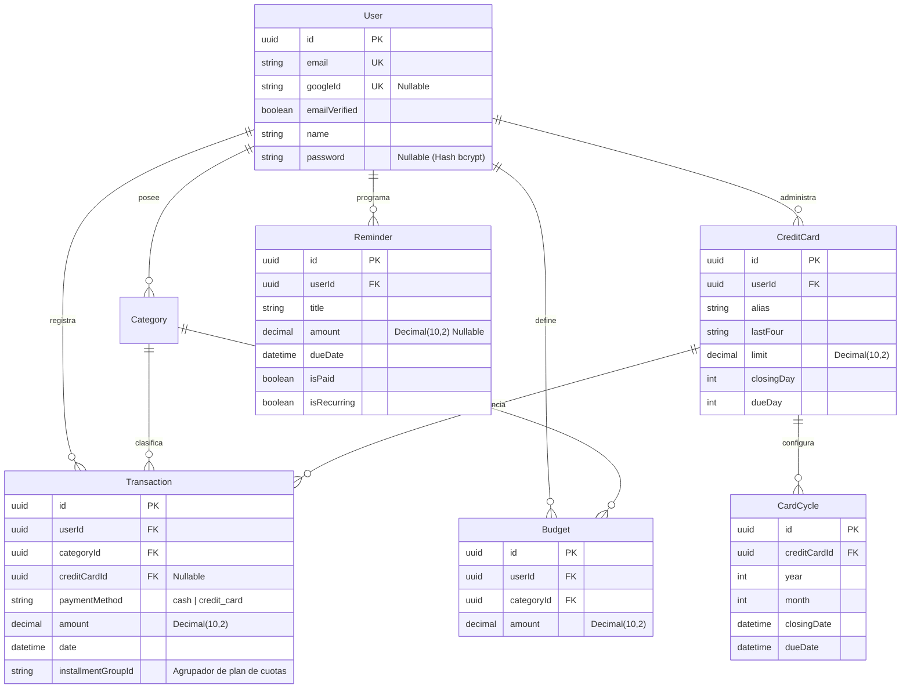

# Lumi — Plataforma de Finanzas Personales y Proyección de Tarjetas

**Lumi** es una aplicación Full-Stack de finanzas personales diseñada para resolver las particularidades reales del manejo financiero cotidiano (cierres dinámicos de tarjetas de crédito según calendario bancario, compras en cuotas con imputación diferida al ciclo correspondiente, presupuestos con alertas exactas en centavos y simulación de reintegros con tope).

---

## Arquitectura del Sistema

El proyecto está organizado como un monorepo con separación clara de responsabilidades entre el cliente web (**Next.js 16 App Router**) y la API REST (**NestJS 11 + Prisma 7 + PostgreSQL 16**).



### Modelo de Datos Relacional (ERD)



---

## Decisiones de Ingeniería y Seguridad Destacadas

1. **Flujo OAuth 2.0 Endurecido (`state` HMAC + PKCE `S256` + Códigos Efímeros de Uso Único)**:
   - El inicio de sesión con Google valida el parámetro `state` mediante firma HMAC-SHA256 vinculada a una cookie `HttpOnly` (`OAuthStateStore`), aplica **PKCE (`S256`)** y verifica `email_verified` antes de vincular cuentas por correo (invalidando contraseñas locales previas no verificadas para evitar *pre-account takeover*).
   - En lugar de exponer el JWT en la URL de retorno, el backend emite un código efímero con **TTL de 60 segundos** y **un único uso** (`POST /auth/google/exchange`) y soporta revocación inmediata por `jti` en `POST /auth/logout`.
2. **Aislamiento por Usuario y Prevención de IDOR**:
   - El `userId` se obtiene exclusivamente del JWT verificado criptográficamente en la API (`JwtStrategy`). El middleware de Next.js actúa como guarda de navegación (UX), mientras que la autorización real se aplica en cada servicio del backend antes de leer o mutar categorías, tarjetas, ciclos, presupuestos, transacciones y recordatorios.
3. **Cálculo de Cuotas en Centavos Enteros e Imputación según Cierre (`InstallmentCalculator.calculate`)**:
   - Los importes se persisten como `DECIMAL(10, 2)` en PostgreSQL y las divisiones en cuotas se calculan en **centavos enteros** (`Math.floor(totalCents / installments)` más distribución del resto en la primera cuota) e insertan mediante `prisma.transaction.createMany`, exigiendo un mínimo de `\$0,01` por cuota.
   - Si una compra con tarjeta ocurre después del día de cierre (`CardCycle` personalizado o `closingDay` habitual), `InstallmentCalculator.calculate` desplaza automáticamente la primera cuota al período de facturación siguiente.
4. **Defensa en Profundidad y Validaciones de Frontera**:
   - Cabeceras HTTP con **Helmet**, rate limiting global y por ruta con `@nestjs/throttler`, y `ValidationPipe` global (`whitelist`, `forbidNonWhitelisted`, `transform`).
   - Validación de longitud máxima en **bytes UTF-8 (`@MaxUtf8Bytes(72)`)** para respetar el límite criptográfico real de `bcrypt` incluso con caracteres multibyte, y validadores de fechas calendario reales (`@IsValidCalendarDate()`).

---

## Stack Tecnológico

| Capa | Tecnologías |
| :--- | :--- |
| **Frontend (`web/`)** | Next.js 16.4 (App Router), React 19, TypeScript 5, Tailwind CSS v4, Zustand 5, Framer Motion 12, Recharts 3, Lucide Icons |
| **Backend (`api/`)** | NestJS 11, TypeScript 5 (`strict: true`), Prisma 7 (`@prisma/adapter-pg`), Passport (JWT & Google OAuth 2.0), Swagger / OpenAPI, Nest Schedule (Cron) |
| **Base de Datos** | PostgreSQL 16 (Docker Compose local / Supabase compatible) |
| **Testing & QA** | Jest 30 (Tests unitarios y E2E con Supertest), ESLint 9 (Flat Config), GitHub Actions CI |

---

## Guía de Inicio Rápido (Desarrollo Local)

### 1. Requisitos previos
- **Node.js** `^20.19.0 || ^22.12.0 || >=24.0.0`
- **Docker** y **Docker Compose** (o una instancia PostgreSQL 16 local/remota)

### 2. Levantar la Base de Datos PostgreSQL
Desde la raíz del repositorio:
```bash
docker compose up -d
```

### 3. Configurar y ejecutar el Backend (`api/`)
```bash
cd api
cp .env.example .env
# Ajustar DATABASE_URL, DIRECT_URL y JWT_SECRET en api/.env
npm install
npx prisma migrate deploy
npx prisma generate
npm run start:dev
```
- **API Base URL**: `http://localhost:3000`
- **Documentación Interactiva (Swagger UI)**: `http://localhost:3000/api/docs`
- **Health Check**: `http://localhost:3000/health`

### 4. Configurar y ejecutar el Frontend (`web/`)
En una nueva terminal:
```bash
cd web
cp .env.example .env.local
npm install
npm run dev -- -p 3001
```
- **Aplicación Web**: `http://localhost:3001`

---

## Ejecución de Tests, Typecheck y Linters

```bash
# Backend: Linter (sin autofix), Typecheck estricto, Tests unitarios, E2E y Build
cd api
npm run lint:check
npm run typecheck
npm test
npm run test:e2e
npm run build

# Frontend: Linter, Typecheck y Build de producción
cd web
npm run lint
npm run typecheck
npm run build
```

---

## Estructura del Monorepo

```text
lumi-workspace/
├── .github/workflows/ci.yml  # Pipeline CI (Lint, Typecheck, Unit, E2E & Build)
├── docker-compose.yml        # Contenedor PostgreSQL 16 vinculado a 127.0.0.1:5432
├── api/                      # Backend NestJS 11 + Prisma 7
│   ├── prisma/               # Esquema relacional y migraciones SQL
│   └── src/
│       ├── auth/             # JWT, Google OAuth 2.0 (state HMAC + PKCE) y canje efímero
│       ├── transactions/     # CRUD, paginación, resumen y motor InstallmentCalculator
│       ├── credit-cards/     # Gestión de plásticos, recomendación y ciclos mensuales
│       ├── budgets/          # Plantillas de tope mensual por categoría y alertas en centavos
│       ├── analytics/        # Comparativa mensual y proyección de cashflow (Forecast)
│       ├── reminders/        # Vencimientos puntuales y recurrentes (isRecurring)
│       └── notifications/    # Cron diario (America/Argentina/Buenos_Aires) vía Resend HTTP
└── web/                      # Frontend Next.js 16 (App Router) + React 19
    └── src/
        ├── app/              # Rutas, layouts y páginas del Dashboard
        ├── components/       # Componentes modulares por dominio y Modal con trampa de foco
        ├── hooks/            # Custom hooks tipados con control de desmontaje y estados de error
        ├── store/            # Estado de sesión con Zustand + sincronización multi-pestaña
        └── lib/              # Cliente HTTP genérico apiFetch<T> con interceptor 401 y timeout
```
