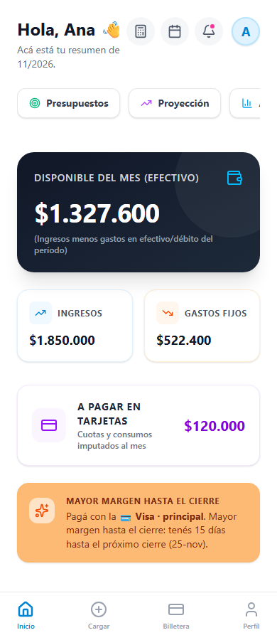
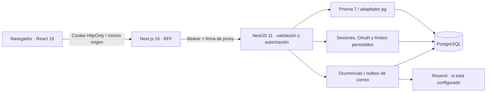

# Lumi · Finanzas personales y tarjetas

[Aplicación](https://lumi-beta-one.vercel.app) · [CI](https://github.com/tomireyes28/lumi/actions/workflows/ci.yml) · [Demo local](docs/portfolio/DEMO.md) · [Decisiones](docs/portfolio/DECISIONES.md) · [Revisión final](docs/portfolio/CIERRE-DE-HALLAZGOS.md)

Lumi permite registrar ingresos y gastos, calcular cuotas según el cierre de cada tarjeta, seguir presupuestos y proyectar compromisos. El proyecto presta especial atención a la diferencia entre comprar, entrar en un resumen y tener un vencimiento de pago.



## Qué se puede demostrar

- Compra en cuotas: reparto exacto en centavos y cierres/vencimientos personalizados por período. Cambiar el cierre de una tarjeta afecta compras nuevas; conserva las cuotas ya registradas.
- Historial paginado y calendario que reúne todas las páginas del mes, incluidos meses con más de 200 movimientos.
- Presupuestos por categoría con estado calculado en centavos. Los límites son plantillas mensuales, no versiones históricas del presupuesto.
- Reglas mensuales con ocurrencias independientes: pagar una no paga la siguiente. Detener una serie conserva pagos y vencidos; editar título/importe actualiza futuras impagas.
- Proyección a 3/6/12 meses. Sin base de ingresos el ratio es `null`, con estado explícito. Las cuotas transcurridas no equivalen a pagos confirmados.
- Login local y Google, sesión HttpOnly del mismo origen, logout confirmado y estado de seguridad compartido entre instancias.
- Errores con reintento, distinción entre guardar y recargar, diálogos con fondo inerte y soporte de movimiento reducido.

## Arquitectura



Producción: Vercel para web, Railway para API y Supabase para PostgreSQL. Todo acceso a tablas de negocio pasa por la API/Prisma. Las tablas son privadas para los roles públicos de Supabase; como Prisma usa un rol con bypass de RLS, la autorización entre usuarios se aplica en la API.

`contracts/http.ts` es la fuente de DTOs de respuesta y validadores Zod. Sus copias dentro de las dos raíces de deploy se verifican en CI. Entradas HTTP usan DTOs de Nest/class-validator. Dinero de entidades admite Decimal serializado como string o número; totales calculados son números finitos. Se preservan `null` y fechas ISO explícitas.

## Fechas y significado financiero

El calendario de negocio usa `America/Argentina/Buenos_Aires`, independientemente del TZ del servidor. Las entradas `YYYY-MM-DD` son fechas calendario; los ISO con offset son instantes.

| Campo | Significado |
| --- | --- |
| `purchaseDate` | Fecha original de compra cuando es conocida |
| `statementYear/Month`, `statementClosingDate` | Resumen al que pertenece la cuota |
| `paymentDueDate` | Vencimiento que usa la proyección |
| `date` | Imputación compatible: cierre para tarjeta, fecha de movimiento para efectivo |
| `Reminder.dueOn` | Día calendario de vencimiento, PostgreSQL DATE |
| `elapsedInstallments` | Cuotas cuyo período transcurrió; no acredita pago |

Los movimientos heredados mantienen los datos conocidos. No se inventa una fecha de compra ni se reclasifican automáticamente. `paidInstallments` se conserva temporalmente como alias de compatibilidad de cuotas transcurridas.

La estimación de ingresos promedia los meses con ingresos entre los tres meses completos anteriores. Si no hay ese historial, usa solo el mes corriente; aumentar el horizonte no suma ingresos futuros a esa base. Es una proyección de obligaciones registradas, no una conciliación bancaria.

## Seguridad y límites operativos

- JWT de siete días identifica una sesión verificada en PostgreSQL. Revocar o vincular Google invalida accesos anteriores según la política de cuenta.
- Google exige identidad estable y email verificado. State/PKCE y canjes de un solo uso están respaldados por PostgreSQL. `POST /auth/exchange` consume el código de retorno (60 segundos).
- El navegador no persiste JWT en localStorage. Next conserva la cookie HttpOnly/Secure en producción; mutaciones del BFF validan Origin. `proxy` solo controla navegación: la API verifica firma, sesión y pertenencia.
- Rate limiting compartido, validación de entradas, Helmet y tablas sin CRUD público. Las operaciones concurrentes de categorías/movimientos usan transacciones y bloqueos con reintento acotado.
- Correo: outbox persistente, timeout, reserva y reintentos con clave/cuerpo estables. `accepted` significa aceptación del proveedor, no entrega al buzón. Se exige clave y remitente explícitos. La configuración del dominio en Resend y la entrega externa siguen pendientes de acreditar; la auditoría no envió correos reales.
- Backups/PITR de Supabase y bloqueo del deploy por CI no están acreditados desde los paneles privados. El ensayo de restauración usa datos sintéticos y no sustituye un backup real.

No se presenta el proyecto como una aplicación bancaria ni como una certificación de seguridad o accesibilidad.

## Ejecutar localmente

Node `^20.19.0 || ^22.12.0 || >=24.0.0`; CI usa Node 22. Docker es necesario para los ensayos de base. Se validan PostgreSQL 16 y 17.

```sh
docker compose up -d
cd api
npm ci
# Copiar .env.example a .env y configurar la conexión local y JWT_SECRET.
# Generar un LUMI_PROXY_SECRET privado de 32+ caracteres, igual en API y web.
npx prisma generate
npx prisma migrate deploy
npm run start:dev
```

En otra terminal:

```sh
cd web
npm ci
# Copiar .env.example a .env.local. API_URL/NEXT_PUBLIC_API_URL: http://localhost:3000.
# Configurar el mismo LUMI_PROXY_SECRET, sin prefijo NEXT_PUBLIC_.
npm run dev
```

Web: `http://localhost:3001`. API: `http://localhost:3000`. Swagger: `http://localhost:3000/api/docs`; el bootstrap actual lo registra también en producción, sin depender de `ENABLE_SWAGGER`. Swagger describe rutas/inputs; el contrato comprobable de respuestas es `contracts/http.ts`. Health: `/health`; versión: `/version`.

Para una demo con datos y sin credenciales reales, seguir [DEMO.md](docs/portfolio/DEMO.md). Su seed solo acepta una base local llamada `lumi_demo` y requiere activación explícita. Nunca se ejecuta al arrancar producción.

## Pruebas reproducibles

```sh
cd api
npm run lint:check
npm run typecheck
npm run test:dates       # toda la suite unitaria en UTC y Buenos Aires
npm run test:e2e         # HTTP con Prisma simulado
npm run build

cd ../web
npm run lint
npm run typecheck
npm run test:unit        # BFF, contratos, fechas y paginación
npm run build
npx playwright install chromium
npm run test:ui          # escritorio/móvil con respuestas sintéticas
```

Integración real exige `TEST_DATABASE_URL` explícito, loopback y base `lumi_test_*`. No se lee `.env` como fallback de tests. Con una instancia local desechable:

```sh
# Configurar TEST_DATABASE_URL en ambas terminales con su conexión local aislada.
# Para el ensayo dump/restore, configurar además TEST_POSTGRES_CONTAINER.
cd api
npm run test:integration
npm run test:demo
cd ../web
npm run test:full-stack
```

El último comando inicia Next/BFF/Nest reales, crea y migra una base temporal, ejecuta el recorrido financiero con Chromium y elimina la base. El job de CI proporciona PostgreSQL y ejecuta la misma prueba. No requiere cuentas de Google ni Resend.

CI contiene cinco jobs: API, web, PostgreSQL 16, PostgreSQL 17 y navegador/BFF/API/PostgreSQL. Las regresiones comprueban también sesiones después de reinicios, OAuth concurrente, límites compartidos, permisos SQL, migraciones, restore y outbox con proveedor simulado. Un porcentaje unitario no representa todas esas capas.

## Estructura

```text
api/             Nest, Prisma, migraciones y scripts locales de test/demo
web/             Next, BFF, componentes, hooks y pruebas de navegador
contracts/       DTOs y validadores canónicos de respuestas HTTP
scripts/         Sincronización verificable del contrato entre raíces de deploy
docs/portfolio/  Demo, capturas, decisiones y matriz de cierre
docs/revision-2026-11-09/  Auditoría y evidencia histórica por etapa
```

Al 10/11/2026: `npm audit --omit=dev` sin avisos en ambos proyectos; frontend sin avisos totales. La API conserva ocho avisos bajos de herramientas derivados de `deepmerge`, sin parche publicado. Alcance y seguimiento: [ETAPA-6.md](docs/revision-2026-11-09/ETAPA-6.md).
