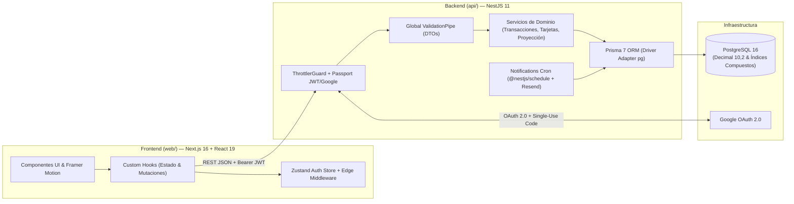
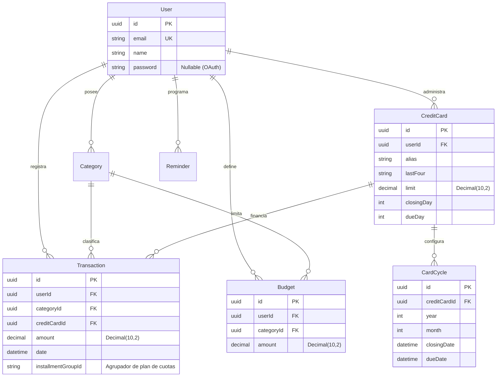

# Lumi — Plataforma de Finanzas Personales y Proyección de Tarjetas

**Lumi** es una aplicación Full-Stack de finanzas personales diseñada para resolver las particularidades reales del manejo financiero cotidiano (como cierres dinámicos de tarjetas de crédito según calendario bancario, compras en cuotas con imputación diferida de flujo de caja, presupuestos con umbrales de alerta y simulación de reintegros con tope).

---

## Arquitectura del Sistema

El proyecto está organizado como un monorepo con separación estricta de responsabilidades entre el cliente web (**Next.js 16 App Router**) y la API REST (**NestJS 11 + Prisma 7 + PostgreSQL 16**).



### Modelo de Datos Relacional (ERD)



---

## Decisiones de Ingeniería y Seguridad Destacadas

1. **Intercambio OAuth 2.0 con Códigos Efímeros de Uso Único (Anti-Token Leakage)**:
   - En lugar de redirigir desde el callback de Google con el JWT expuesto en la query string (`?token=...`), el backend genera un código UUID efímero en memoria con **TTL de 60 segundos** y **un único uso** (`POST /auth/exchange`). Una vez canjeado, el código se destruye inmediatamente para prevenir ataques de *replay* o filtración en historiales/logs.
2. **Aislamiento Multi-Tenant y Prevención de IDOR**:
   - Ningún endpoint confía en identificadores de usuario enviados por el cliente. El `userId` se extrae exclusivamente del payload verificado del JWT (`req.user.userId`) y cada operación `PATCH`/`DELETE`/`POST` verifica pertenencia de recursos (categorías, tarjetas, ciclos, presupuestos y recordatorios) antes de mutar datos.
3. **Aritmética Financiera Exacta e Imputación de Cuotas**:
   - Los montos monetarios se almacenan como `DECIMAL(10, 2)` en PostgreSQL.
   - El motor de cuotas (`calculateInstallmentPlan`) determina dinámicamente en qué resumen ingresa la primera cuota comparando la fecha de compra contra la fecha de cierre personalizada (`CardCycle`) o habitual (`closingDay`) de la tarjeta, y asigna cualquier resto de centavos (ej. `\$1.000 / 3`) a la primera cuota (`\$333.34` + `\$333.33` + `\$333.33 = \$1.000,00`) dentro de una transacción atómica `prisma.$transaction`.
4. **Defensa en Profundidad (Hardening)**:
   - Cabeceras HTTP seguras mediante **Helmet**, rate limiting global con `@nestjs/throttler` y límites estrictos (`10 req/min`) en rutas de autenticación (`/auth/login`, `/auth/register`, `/auth/exchange`).
   - Validación estricta de DTOs y query parameters con `ValidationPipe` (`whitelist: true`, `forbidNonWhitelisted: true`, `transform: true`) y tope de `72` caracteres en contraseñas para mitigar truncamiento y DoS de CPU en `bcrypt`.

---

## Stack Tecnológico

| Capa | Tecnologías |
| :--- | :--- |
| **Frontend (`web/`)** | Next.js 16.2 (App Router), React 19, TypeScript 5, Tailwind CSS v4, Zustand 5, Framer Motion 12, Recharts 3, Lucide Icons |
| **Backend (`api/`)** | NestJS 11, TypeScript 5, Prisma 7 (`@prisma/adapter-pg`), Passport (JWT & Google OAuth 2.0), Swagger / OpenAPI, Nest Schedule (Cron), Resend |
| **Base de Datos** | PostgreSQL 16 (Docker Compose local / Supabase compatible) |
| **Testing & QA** | Jest 30 (Unit Tests de servicios y algoritmos financieros), ESLint 9 (Flat Config), GitHub Actions CI |

---

## Guía de Inicio Rápido (Desarrollo Local)

### 1. Requisitos previos
- **Node.js** >= 20.x
- **Docker** y **Docker Compose** (o una instancia PostgreSQL local/remota)

### 2. Levantar la Base de Datos PostgreSQL
Desde la raíz del repositorio:
```bash
docker compose up -d
```

### 3. Configurar y ejecutar el Backend (`api/`)
```bash
cd api
cp .env.example .env
# Ajustar DATABASE_URL y JWT_SECRET en api/.env
npm install
npx prisma migrate deploy
npx prisma generate
npm run start:dev
```
- **API Base URL**: `http://localhost:3000`
- **Documentación Interactiva (Swagger UI)**: `http://localhost:3000/api/docs`
- **Health Check**: `http://localhost:3000/health`

### 4. Configurar y ejecutar el Frontend (`web/`)
En una nueva terminal:
```bash
cd web
cp .env.example .env.local
npm install
npm run dev -- -p 3001
```
- **Aplicación Web**: `http://localhost:3001`

---

## Ejecución de Tests y Linters

```bash
# Backend: Tests unitarios (Jest), Linter y Build
cd api
npm test
npm run lint
npm run build

# Frontend: Linter (ESLint + React Compiler) y Build de producción
cd web
npm run lint
npm run build
```

---

## Estructura del Monorepo

```text
lumi-workspace/
├── .github/workflows/ci.yml  # Pipeline de Integración Continua (Lint, Test & Build)
├── docker-compose.yml        # Contenedor PostgreSQL 16 con healthcheck
├── api/                      # Backend NestJS 11 + Prisma 7
│   ├── prisma/               # Esquema relacional y migraciones SQL
│   └── src/
│       ├── auth/             # JWT, Google OAuth 2.0 y canje de códigos efímeros
│       ├── transactions/     # CRUD, paginación y motor de cálculo de cuotas
│       ├── credit-cards/     # Gestión de plásticos, recomendación de uso y ciclos mensuales
│       ├── budgets/          # Topes mensuales por categoría y alertas de ejecución
│       ├── analytics/        # Comparativa intermensual y proyección de cashflow (Forecast)
│       ├── reminders/        # Vencimientos y pagos recurrentes
│       └── notifications/    # Cron job diario de alertas por email (Resend)
└── web/                      # Frontend Next.js 16 (App Router) + React 19
    └── src/
        ├── app/              # Rutas, layouts y páginas del Dashboard
        ├── components/       # Componentes modulares por dominio y UI accesible
        ├── hooks/            # Custom hooks con manejo de estado y cancelación segura
        ├── store/            # Estado global de sesión con Zustand + sincronización de Cookie
        └── lib/              # Cliente HTTP con interceptor 401 y timeout
```
